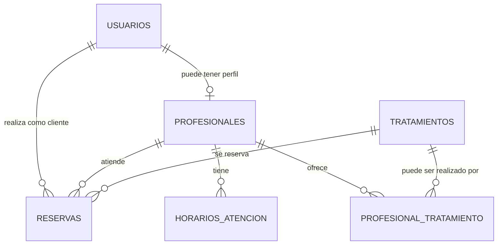

# Diseño inicial de la base de datos – Estética Turnos

**Ubicación prevista en el repositorio:** `docs/base-de-datos.md`  
**Motor:** PostgreSQL  
**Estado:** diseño inicial basado en `docs/spec.md`

## 1. Objetivo

La base de datos almacenará las cuentas de usuario, los profesionales, los tratamientos, los horarios de atención y las reservas.

Se propone un diseño relacional sencillo. Las relaciones y restricciones de este documento deberán implementarse en PostgreSQL mediante Prisma y sus migraciones.

## 2. Entidades y relaciones

- Un **usuario** puede tener un perfil de profesional, pero no todos los usuarios son profesionales.
- Un **profesional** puede realizar varios tratamientos.
- Un **tratamiento** puede ser realizado por varios profesionales.
- La relación entre profesionales y tratamientos se representa mediante `profesional_tratamiento`.
- Un **profesional** puede tener varios horarios de atención, uno por cada día que atiende.
- Un **cliente** puede realizar muchas reservas.
- Un **profesional** puede tener muchas reservas.
- Un **tratamiento** puede aparecer en muchas reservas.

## 3. Modelo relacional propuesto

### 3.1. `usuarios`

Almacena las cuentas de acceso.

| Campo | Tipo PostgreSQL | Restricciones | Descripción |
|---|---|---|---|
| `id` | `SERIAL` | PK | Identificador del usuario. |
| `nombre` | `VARCHAR(100)` | NOT NULL | Nombre y apellido. |
| `email` | `VARCHAR(255)` | NOT NULL, UNIQUE | Email de acceso. |
| `password_hash` | `VARCHAR(255)` | NOT NULL | Hash de la contraseña. |
| `rol` | `VARCHAR(20)` | NOT NULL | `cliente`, `profesional` o `admin`. |
| `activo` | `BOOLEAN` | NOT NULL, DEFAULT TRUE | Indica si la cuenta puede ingresar. |
| `created_at` | `TIMESTAMP` | NOT NULL, DEFAULT CURRENT_TIMESTAMP | Fecha de creación. |

**Reglas:** el email debe guardarse normalizado en minúsculas. La contraseña nunca se almacena en texto plano. El rol se valida en el backend y también debe limitarse en la base de datos a los valores permitidos.

### 3.2. `profesionales`

Almacena los datos propios de cada profesional. Se vincula con una cuenta de usuario.

| Campo | Tipo PostgreSQL | Restricciones | Descripción |
|---|---|---|---|
| `id` | `SERIAL` | PK | Identificador del profesional. |
| `usuario_id` | `INTEGER` | NOT NULL, UNIQUE, FK → `usuarios.id` | Cuenta asociada. |
| `descripcion` | `TEXT` | NULL | Presentación o especialidad del profesional. |
| `activo` | `BOOLEAN` | NOT NULL, DEFAULT TRUE | Disponibilidad para recibir nuevas reservas. |

La aplicación comenzará con dos profesionales registrados. Se usa una tabla para que cada uno pueda tener su propia agenda y sus propias especialidades.

### 3.3. `tratamientos`

Almacena los servicios que ofrece el centro.

| Campo | Tipo PostgreSQL | Restricciones | Descripción |
|---|---|---|---|
| `id` | `SERIAL` | PK | Identificador del tratamiento. |
| `nombre` | `VARCHAR(100)` | NOT NULL, UNIQUE | Nombre del tratamiento. |
| `descripcion` | `TEXT` | NULL | Descripción del servicio. |
| `duracion_minutos` | `INTEGER` | NOT NULL, CHECK > 0 | Duración del turno. |
| `precio` | `NUMERIC(10,2)` | NOT NULL, CHECK >= 0 | Precio vigente. |
| `activo` | `BOOLEAN` | NOT NULL, DEFAULT TRUE | Indica si se puede reservar. |

### 3.4. `profesional_tratamiento`

Resuelve la relación muchos a muchos entre profesionales y tratamientos.

| Campo | Tipo PostgreSQL | Restricciones | Descripción |
|---|---|---|---|
| `profesional_id` | `INTEGER` | PK compuesta, FK → `profesionales.id` | Profesional. |
| `tratamiento_id` | `INTEGER` | PK compuesta, FK → `tratamientos.id` | Tratamiento habilitado. |

La clave primaria compuesta (`profesional_id`, `tratamiento_id`) evita repetir la misma asociación.

### 3.5. `horarios_atencion`

Define los horarios habituales de cada profesional.

| Campo | Tipo PostgreSQL | Restricciones | Descripción |
|---|---|---|---|
| `id` | `SERIAL` | PK | Identificador del horario. |
| `profesional_id` | `INTEGER` | NOT NULL, FK → `profesionales.id` | Profesional. |
| `dia_semana` | `SMALLINT` | NOT NULL, CHECK entre 1 y 7 | Día de la semana. |
| `hora_inicio` | `TIME` | NOT NULL | Inicio de atención. |
| `hora_fin` | `TIME` | NOT NULL | Fin de atención. |

**Restricciones adicionales:**
- `hora_fin` debe ser posterior a `hora_inicio`.
- Debe existir como máximo un registro por profesional y día: `UNIQUE (profesional_id, dia_semana)`.
- Se usará la convención ISO: lunes = 1 y domingo = 7.

### 3.6. `reservas`

Almacena cada turno solicitado.

| Campo | Tipo PostgreSQL | Restricciones | Descripción |
|---|---|---|---|
| `id` | `SERIAL` | PK | Identificador de la reserva. |
| `cliente_id` | `INTEGER` | NOT NULL, FK → `usuarios.id` | Usuario que reservó. |
| `profesional_id` | `INTEGER` | NOT NULL, FK → `profesionales.id` | Profesional asignado. |
| `tratamiento_id` | `INTEGER` | NOT NULL, FK → `tratamientos.id` | Tratamiento reservado. |
| `inicio` | `TIMESTAMPTZ` | NOT NULL | Fecha y hora de inicio. |
| `fin` | `TIMESTAMPTZ` | NOT NULL | Fecha y hora de finalización. |
| `precio_aplicado` | `NUMERIC(10,2)` | NOT NULL, CHECK >= 0 | Precio guardado al reservar. |
| `estado` | `VARCHAR(20)` | NOT NULL, DEFAULT `confirmado` | Estado actual. |
| `created_at` | `TIMESTAMPTZ` | NOT NULL, DEFAULT CURRENT_TIMESTAMP | Fecha de creación. |

**Restricciones adicionales:**
- `fin` debe ser posterior a `inicio`.
- `estado` solo puede ser `confirmado`, `completado` o `cancelado`.
- La reserva conserva `precio_aplicado` aunque luego cambie el precio del tratamiento.
- Las reservas canceladas y completadas no se eliminan.
- Las reservas con estado `confirmado` son las que bloquean el horario.

## 4. Diagrama de relaciones

## 5. Validaciones que corresponden al backend

No todas las reglas pueden resolverse únicamente con restricciones simples de tablas. El backend debe validar:

1. Que el usuario que realiza una reserva tenga rol `cliente`.
2. Que el profesional y el tratamiento estén activos.
3. Que el profesional esté asociado al tratamiento.
4. Que la fecha esté dentro del período permitido de 30 días y no sea pasada.
5. Que el turno esté dentro del horario de atención de ese día.
6. Que la duración coincida con la duración vigente del tratamiento.
7. Que no exista otra reserva confirmada que se superponga con el intervalo solicitado.
8. Que el cliente solo consulte o cancele sus propias reservas.
9. Que la cancelación solicitada por un cliente respete las 24 horas de anticipación.
10. Que solo el profesional asignado o un administrador pueda marcar una reserva como completada.

La comprobación de superposición debe realizarse dentro de una transacción para reducir el riesgo de que dos solicitudes simultáneas reserven el mismo horario. Se debe complementar con una estrategia de concurrencia adecuada en PostgreSQL.

## 6. Decisiones de diseño

- Se separan `usuarios` y `profesionales` para que los datos de acceso no se mezclen con los datos propios del perfil profesional.
- Se utiliza `profesional_tratamiento` porque un profesional puede realizar varios tratamientos y un tratamiento puede estar disponible con varios profesionales.
- Se guarda `precio_aplicado` en `reservas` para conservar el precio histórico.
- Se guardan `inicio` y `fin` para facilitar las consultas de disponibilidad y superposición.
- Se utiliza `TIMESTAMPTZ` para almacenar instantes de tiempo y se presentarán al usuario según `America/Argentina/Buenos_Aires`.
- No se crea una tabla de sucursales porque el alcance actual contempla una sola sucursal.

## 7. Próximo paso

Revisar este diseño y, una vez aprobado, definir el esquema de Prisma y generar la primera migración de PostgreSQL. Después se podrán implementar los servicios y endpoints del backend sobre esta estructura.
